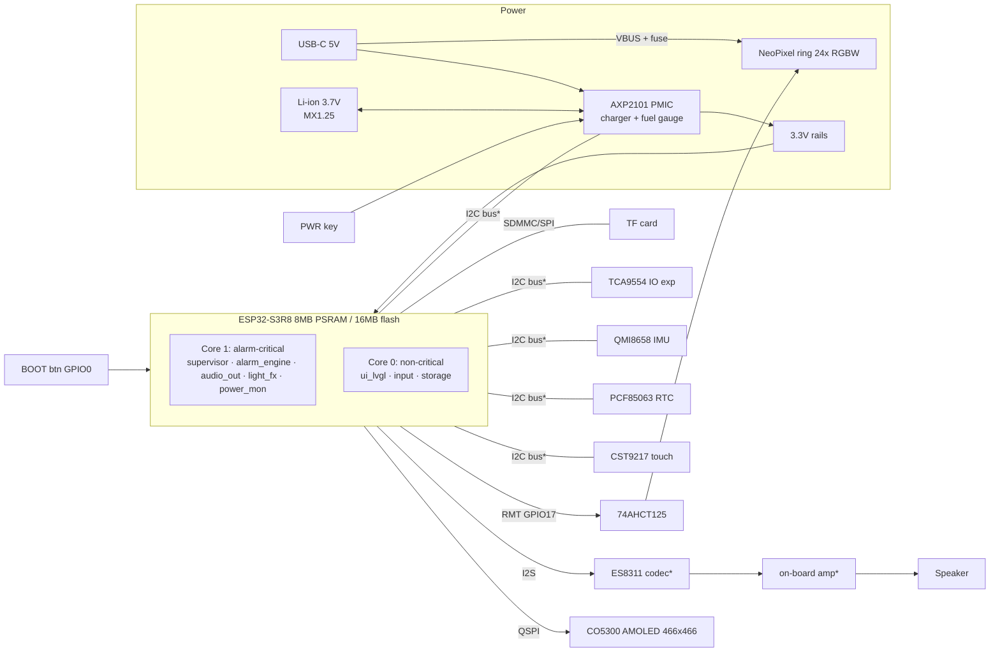
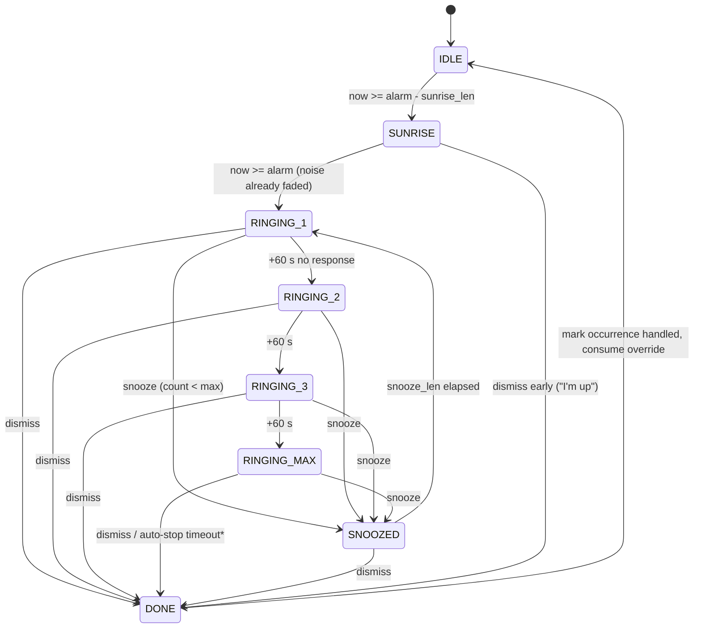

# Firmware

> Phase 0 content: architecture, task layout and alarm state machine.
> Phase 3 adds: module APIs, data model, NVS layout detail, build/flash steps.
> Bluetooth is optional and used only for time sync: see BLUETOOTH.md (D-043).

Framework: ESP-IDF v5.x + LVGL 9 + FreeRTOS (see [D-001](DECISIONS.md#d-001--firmware-framework-esp-idf--lvgl-9--freertos)).

## 1. System block diagram

`*` = confirmed in Phase 1 from Waveshare's hardware reference (one shared I2C bus; ES8311 + NS4150B, amp enable on GPIO46). The ring is fed from USB VBUS, not from a boost (D-012). Pins are in [HARDWARE.md](HARDWARE.md).

## 2. RTOS task layout

Critical tasks are on **core 1**. Nothing on core 1 waits on anything owned by core 0.

| Task | Core | Prio | Stack | Trigger / period | Watchdog | Role |
|------|------|------|-------|------------------|----------|------|
| `supervisor` | 1 | 22 | 4 KB | 1 s | TWDT | Heartbeat checks, boot-loop guard, fault log, safe-mode decision |
| `alarm_engine` | 1 | 20 | 6 KB | 1 s tick + queue + BOOT GPIO ISR | TWDT | Owns schedule in RAM, computes next alarm, runs state machine, commands audio/light |
| `audio_out` | 1 | 19 | 8 KB | I2S DMA, ~10 ms blocks | TWDT | Noise generator / file decode, software gain, fades, alarm tones |
| `light_fx` | 1 | 17 | 4 KB | 20 ms (50 Hz) | TWDT | Sunrise curve, night/reading light, current-cap limiter, RMT output |
| `power_mon` | 1 | 12 | 4 KB | 2 s + AXP2101 IRQ | TWDT | Battery %, USB state, runtime prediction, load shedding, low-batt warnings |
| `storage` | 1 | 8 | 6 KB | queue | — | A/B NVS writes with verify (write-behind, never on the fire path) |
| `input` | 0 | 10 | 4 KB | touch/IMU INT | heartbeat | Gesture recognition → UI events, snooze events → alarm queue |
| `ui_lvgl` | 0 | 6 | 16 KB | 5–33 ms | heartbeat | Screens, night theme, display power |
| `ble` (NimBLE host) | 0 | 5 | IDF default | events | heartbeat | **Optional time sync.** Never started unless you tap Phone; on for about 2 minutes (D-043, BLUETOOTH.md). |

Inter-task channels:
- `alarm_cmd_q` (UI/input → alarm_engine): validated commands such as `SET_DAY`, `SET_OVERRIDE`, `SNOOZE`, `DISMISS`, `PREVIEW`.
- `alarm_state` snapshot (alarm_engine → everyone): double-buffered struct + sequence counter, read without locks.
- `audio_cmd_q`, `light_cmd_q` (alarm_engine / UI → workers): target level + ramp time.
- I2C: one bus mutex, every access with a ≤ 50 ms timeout and bus recovery on failure. **Not used on the alarm fire path.**

## 3. Alarm state machine (overview)

`*` The auto-stop policy is an open decision. Default proposal: sound stops after 30 min of ringing, light stays at full and the screen shows "Alarm missed at 07:00".

The step levels and timings above are placeholders and become final in Phase 3. On boot, the engine rebuilds its state from the occurrence time and `now`, so it resumes at the right stage (R21) and catches up on missed alarms (R20).

Optional UI-side feature: the Focus timer (D-047) runs on core 0 and never touches the alarm path. The pre-dawn sleep sound (D-044) is a command from `alarm_engine` to `audio_out`.

## 3a. Code layout (Phase 3, D-048)
| Path | Role |
|------|------|
| `components/clockcore` | Pure C, tested on a computer: `civil` (dates), `tz` (POSIX rule zones), `sched` (week, skip, tomorrow, next alarm), `alarm_sm` (state machine), `dawn` (light and pre-dawn sound curves), `storage` (CRC, A/B records, schedule format, PCF85063, drift) |
| `main/alarm_engine.c` | Core 1 task: loads storage, reads `time()`, steps the machine once a second, fills the snapshot in `hw.h` |
| `main/light_fx.c`, `audio_out.c`, `rtc.c`, `console.c` | Ring (dawn curve, dithering, current cap), alarm chime, PCF85063 restore and set, bench console |
| `main/store.c` | NVS: schedule A/B records, machine state, region string |
| `test/` | Host tests and the independent daylight-saving data generator |

## 4. Longevity notes (D-030, D-031)

- Wi-Fi is never initialised. Bluetooth is initialised only when the user taps Phone, and shut down after the sync or two minutes (D-043).
- `time_t` is 64-bit (build assert). Dates are computed by the firmware, never trusted from the RTC's weekday.
- Region rules are stored as time-zone rule strings. An SD-card file `region.txt` can replace them. Details in [LONGEVITY.md](LONGEVITY.md).
- `light_fx` follows [LIGHT.md](LIGHT.md): a 64-point dawn table, caps by time of day, dithering, the 0.9 A limit.
- A small `hw_profile` header records which optional parts are fitted (D-025).
