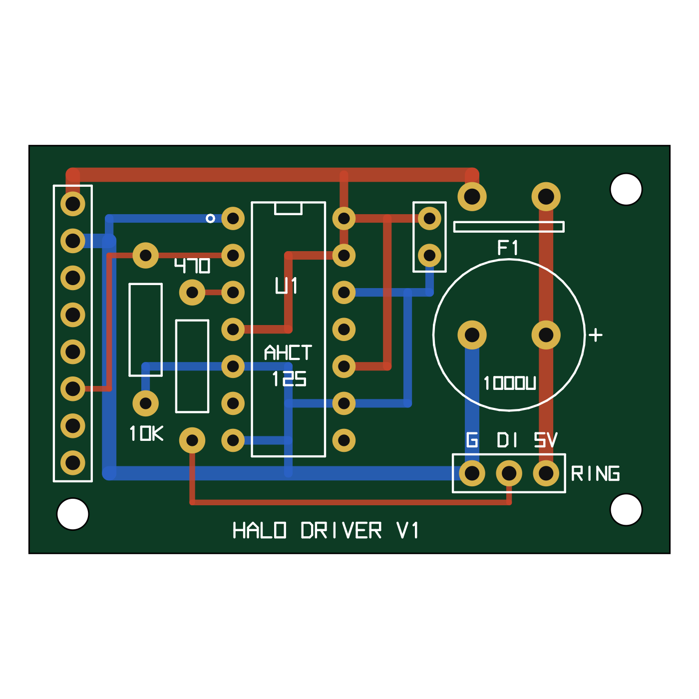

# Hardware

Phase 1 · 2026-11-12 · Power reasoning is in [POWER.md](POWER.md).

Sources for board facts: Waveshare's `HARDWARE_REFERENCE.md` and `pin_config.h` in
`github.com/waveshareteam/ESP32-S3-Touch-AMOLED-1.75`, and the Waveshare wiki.
**The schematic PDF itself has not been read yet.** Items marked ⚠ must be checked on the real board (§6).

## 1. Bill of materials

Prices are approximate (USD, late 2026) and not checked against a live listing.

| # | Part | Part number / source | Qty | ~Cost | Status |
|---|------|----------------------|-----|-------|--------|
| 1 | Waveshare ESP32-S3-Touch-AMOLED-1.75 | Waveshare SKU 31261 | 1 | $30 | Have |
| 2 | NeoPixel Ring 24× RGBW, warm white ~3000 K | Adafruit #2861 | 1 | $20 | Have |
| 3 | Speaker 8 Ω 2 W, 20 × 30 × 6.8 mm cavity type, 1.25 mm 2-pin plug, 120 mm lead | Waveshare "8Ω 2W Speaker (B)", SKU 27859 | 1 | $2 | Have |
| 4 | Level shifter 74AHCT125, DIP-14 | Adafruit #1787, or TI SN74AHCT125N | 1 | $1.50 | **Optional** (add if the ring flickers) |
| 5 | Resettable fuse, 1.1 A hold | Bourns MF-R110 | 1 | $0.50 | Buy (needed before the ring goes above 0.3 A) |
| 6 | Electrolytic capacitor 1000 µF, 10–16 V, radial, **10 mm diameter, 5 mm lead pitch** | e.g. Panasonic EEU-FR1C102 (check the pitch before ordering) | 1 | $0.60 | Buy (needed before the ring goes above 0.3 A) |
| 7 | Resistor 470 Ω, ¼ W | any | 1 | $0.05 | Buy (needed before the ring goes above 0.3 A) |
| 8 | Resistor 10 kΩ, ¼ W | any | 1 | $0.05 | **Optional** (only with the level shifter) |
| 9 | Ceramic capacitor 100 nF | any | 1 | $0.05 | **Optional** (only with the level shifter) |
| 10 | Li-polymer cell 3.7 V 2000 mAh, 103450, with protection, MX1.25 2-pin | generic; **check polarity** | 1 | $9 | Recommended (owner agreed). The firmware runs without it. |
| 11 | USB-C power adapter 5 V 3 A | e.g. Raspberry Pi 15 W USB-C supply | 1 | $8 | Buy if you have none |
| 12 | ~~MX1.25 pigtail for the speaker~~ | Not needed: the speaker's own 1.25 mm plug fits the board | — | — | — |
| 13 | *Later:* Halo driver PCB, 44 × 28 mm, 2-layer | `/pcb/halo-driver/halo-driver-gerbers.zip`, see §7 | 1 (min. order usually 5) | ~$5 + shipping | After Phase 4 |
| 13b | **First build:** half-size solderless breadboard + male-to-male and male-to-female jumper wires | any | 1 | $6 | **Optional** |
| 13a | Pin header 1×8 and 1×3, 2.54 mm; DIP-14 socket (optional) | any | 1 each | $1 | **Optional** |
| 14 | Wire: 22 AWG (ring power), 26–28 AWG (signals); 1×8 female header housing or Dupont leads | any | — | $3 | Buy |

Baseline total to buy: about **$25**.

> **Optional parts (D-025).** You can build and run the firmware with only the board, ring and speaker. **Required:** rows 1–3, the adapter and wire. **Needed before the ring goes above 0.3 A:** the fuse, capacitor and 470 Ω resistor (rows 5–7, about $1.15, soldered inline, §3b). **Optional:** the level shifter and its two small parts (rows 4, 8, 9), the PCB, the breadboard and headers. **Recommended:** the battery. Each missing part has a defined firmware behaviour (UX.md §10).

## 2. Pin table

### Used by this project

| Function | Pin | Notes |
|----------|-----|-------|
| **NeoPixel data** | **GPIO17** (header pin 6) | Through 74AHCT125. RMT output. |
| Spare (reserved: boost enable in the optional upgrade) | GPIO18 (header pin 7) | Unused in baseline. |
| Spare | GPIO16 (header pin 8) | ⚠ Left unused until the MCLK question is settled (§6). |
| Ring 5 V | VBUS (header pin 1) | Through PTC fuse. |
| Ring / logic ground | GND (header pin 2) | |
| Debug UART | GPIO43 TX, GPIO44 RX (header pins 5, 4) | Optional. USB serial also works. |
| Dismiss fallback button | GPIO0 (BOOT) | Low when pressed. Direct GPIO interrupt. |

### On-board (fixed by Waveshare)

| Function | Pins |
|----------|------|
| Display CO5300, QSPI | CS 12 · SCLK 38 · D0–D3 4, 5, 6, 7 · RESET 39 · TE 13 |
| Touch CST9217 (I2C 0x5A) | INT 11 · RST 40 |
| I2C bus (shared by everything) | SCL 14 · SDA 15 |
| I2S audio | BCLK 9 · LRCK 45 · DOUT→ES8311 8 · DIN←ES7210 10 · MCLK 42 ⚠ |
| Amplifier enable (NS4150B) | GPIO46, direct |
| SD card (1-bit SDMMC) | CMD 1 · CLK 2 · D0 3 · (D3 41 unused) |
| IMU QMI8658 (I2C 0x6B) | INT2 → GPIO21 · INT1 → expander P6 |
| USB | D− 19 · D+ 20 |

### I2C addresses

ES8311 0x18 · TCA9554 0x20 · AXP2101 0x34 · ES7210 0x40 · PCF85063 0x51 · CST9217 0x5A · QMI8658 0x6B

### TCA9554 expander

| Pin | Function | Direction |
|-----|----------|-----------|
| P0–P2 | Free (test points) | — |
| P3 | RTC interrupt | in |
| P4 | PWR button state (high while pressed) | in |
| P5 | AXP2101 interrupt | in |
| P6 | IMU INT1 | in |
| P7 | GNSS reset (‑G variant only) | out |

What this means for the alarm path (D-002): the amplifier enable is a **direct GPIO**, so sound needs no I2C. The RTC and PMIC interrupts arrive **only through the expander**, so firmware polls them once a second and never depends on them to fire an alarm.

## 3. Wiring

```
 BOARD 8-PIN HEADER                                   NEOPIXEL RING (RGBW)
 ──────────────────                                   ────────────────────
 pin 1  VBUS ──┬──[ PTC 1.1A ]──┬────────────────────► 5V / PWR
               │                │(+)
               │            [1000µF]
               │                │(−)
 pin 2  GND ───┼────────────────┴────────────────────► GND
               │
               │        74AHCT125 (DIP-14)
               ├───────► pin 14  VCC          [100nF between pin 14 and pin 7]
 GND ──────────┼───────► pin 7   GND
 GND ──────────┼───────► pin 1   /OE1 (low = enabled)
               │
 pin 6 GPIO17 ─┼──┬────► pin 2   A1
               │ [10k]
               │  │
 GND ──────────┼──┘      pin 3   Y1 ───[ 470Ω ]──────► DIN (Data In)
               │
               └───────► pins 4, 10, 13 (/OE2–4) to VCC = unused gates off
 GND ──────────────────► pins 5, 9, 12 (A2–A4)

 SPEAKER:  board MX1.25 "SPK" connector ── 2 wires ── speaker terminals
 BATTERY:  board MX1.25 "BAT" connector ── LiPo 2000 mAh (check polarity first)
 USB-C:    5 V 3 A adapter into the board's USB-C port
```

Build notes:
- Put the 1000 µF capacitor and the 470 Ω resistor **close to the ring**, not at the board end.
- Mind the capacitor's polarity: the striped side goes to GND.
- Use 22 AWG for the two ring power wires. Keep them and the data wire under about 15 cm.
- Wire to the ring's **Data In** pad. Data Out stays unconnected.
- The ring's ground and the board's ground must be joined (they are, through header pin 2).

## 3b. Inline build (D-025): no breadboard, no PCB

Three small parts soldered inline between the board header and the ring:

```
 header VBUS ──[ fuse 1.1 A ]──────────┬────────► ring PWR / 5V
                                       │
                                   [1000 µF]      stripe (−) side to GND
                                       │
 header GND  ──────────────────────────┴────────► ring GND

 header 17   ──[ 470 Ω ]────────────────────────► ring IN (Data In)
```

- Solder the capacitor straight across the ring's PWR and GND holes, on the ring itself.
- Put the 470 Ω resistor in the data wire close to the ring.
- Insulate every joint with heat-shrink.
- Keep all three wires under about 15 cm.
- The bring-up test already ran this way (without the fuse, capacitor and resistor) at 0.3 A.
- **Before raising the cap from 0.3 A to 0.9 A:** fit these three parts, then watch for flicker for 30 min. If it flickers, add the level shifter (§3).

## 3a. Breadboard build (optional; the inline build in §3b needs no breadboard)

Same circuit as above, no PCB.

1. **Chip and resistors on the breadboard.** Push the 74AHCT125 across the centre gap. Wire its pins as in the diagram: 14 to 5 V, 7 to GND, 1 to GND, 2 to GPIO17 (with the 10 kΩ from pin 2 to GND), 3 through the 470 Ω to the ring's Data In. Tie pins 4, 10, 13 to 5 V and pins 5, 9, 12 to GND. Put the 100 nF across pins 14 and 7.
2. **Keep the ring's power off the breadboard.** Breadboard contacts are only good for about half an amp. Solder (or join with a lever connector) VBUS → fuse → ring 5 V directly, and ring GND → header GND directly. Solder the 1000 µF across the ring's 5 V and GND pads, stripe to GND.
3. **Take 5 V and GND for the chip** from those same joints with thin jumper wires.
4. **From the Waveshare board you need three connections:** VBUS, GND and GPIO17 (see §2 for where they are on the 8-pin header).
5. For the first power-up, set the firmware current cap to 0.3 A, check nothing gets warm, then raise it to 0.9 A.

## 4. Speaker (8 Ω, 2 W)

- **Amplifier:** NS4150B, a 3 W-class mono class-D chip with a bridged output. Into 8 Ω it can deliver about 1.4 W from a 5 V rail, or about 0.8 W from a battery-level rail. ⚠ Which rail feeds it is not stated by Waveshare (bench check M5).
- **Safety:** either way the amplifier cannot reach the speaker's 2 W rating, so it cannot burn out the speaker.
- **Speaker:** Waveshare 8 Ω 2 W Speaker (B), a sealed 20 × 30 × 6.8 mm cavity unit, so it needs no tuned chamber in the case, only a grille.
- **Wiring:** plug the speaker's own 2-pin 1.25 mm lead into the board's speaker connector. **Neither wire is ground.** Do not connect either speaker terminal to GND or to anything else. Polarity does not matter with a single speaker.
- **Volume limits in firmware (D-008):**
  - Codec gain fixed at boot at the highest setting that does not clip at full-scale input (set by ear and with a scope or phone spectrum app during bring-up).
  - Alarm: up to 100 % of that. Floor at 30 % so it can never be set silent.
  - White noise and sleep sounds: capped at about 25 % (−12 dB).
  - A 150 Hz high-pass filter on everything. A small speaker cannot reproduce lower notes; sending them only wastes power and makes it rattle.
- Waveshare gives no sensitivity or resonance figure, so loudness is confirmed by ear at bring-up.

## 5. Enclosure-relevant dimensions known so far

| Item | Size |
|------|------|
| RGBW ring | 65.5 mm outer, 52.2 mm inner, 3.25 mm thick |
| Display active area | 1.75" ≈ 44.5 mm across |
| Battery 103450 | 10 × 34 × 50 mm |
| Board outline and mounting holes | ⚠ Not given in text by Waveshare. Measure the board or use their dimension drawing in Phase 4. |

Note for Phase 4: the ring's 52.2 mm opening is wider than the 44.5 mm screen, so the ring can sit around the display as a halo, if the board's outer body fits inside 52 mm. That has to be measured.

## 6. Checks to do on the real board before Phase 3

| # | Check | How | Why |
|---|-------|-----|-----|
| V1 | I2S MCLK is GPIO42, and GPIO16 is free | ✅ Settled on paper: Waveshare's official board package (v3.0.1) uses GPIO42 for MCLK and does not touch GPIO16–18. Confirmed for real when the bring-up test plays sound. | Their two older sources disagreed. |
| V2 | Battery connector polarity | Multimeter on the plug vs the "+" silk mark | Reverse polarity kills the PMIC. |
| V3 | Header VBUS pin really carries USB 5 V and holds ≥ 4.6 V at 0.9 A | POWER.md M2 | Trace and any series part are unknown. |
| V4 | Amplifier supply rail | POWER.md M5 | Sets real maximum loudness. |
| V5 | Board runs from USB with no battery, and from battery with no USB | Try both | Assumed, not stated by Waveshare. |
| V6 | RTC keeps time across a USB unplug with the battery fitted | Unplug for 10 min, compare | R15. |
| V7 | PWR-key long-press power-off can be disabled | Write the AXP2101 setting, hold PWR 15 s | R27. |
| V8 | Ring colour order (owner has #2861, warm white) | ✅ GRBW confirmed by the bring-up test: sunrise and white modes showed the expected colours. | Sunrise colour curves depend on it. |
| V9 | Which way the board's 8-pin header faces and whether pins are fitted | Look at the board | Decides how the halo driver PCB connects (§7). |
| V10 | Board runs and charges when 5 V is fed into the header VBUS pin (nothing in its USB port) | Bench supply or USB breakout into VBUS/GND | Needed for PCB v2 (D-021). |

If V3 fails (VBUS sags or the pin gets warm), the fallback is a separate USB-C breakout in the case that feeds the ring directly, with the board plugged into the same supply.

## 7. Halo driver PCB (v1) — for later, not the first build

> **PCB v2 will add its own rear USB-C socket and ring power switch** (D-021, POWER.md §10). The v1 files below do not have that yet.
>
> **The first build uses a breadboard (§3a).** The PCB is ordered only after the case is designed in Phase 4, so its shape and mounting can be fitted to the case (D-020).

A small board that holds everything from §3: level shifter, fuse, capacitors and resistors. It replaces hand wiring on perfboard.



| Property | Value |
|----------|-------|
| Size | 44 × 28 mm, 2 layers, 1.6 mm FR-4, 1 oz copper |
| Parts | All through-hole, hand-solderable |
| Mounting | 3 × M2 holes (2.2 mm) at (3, 25.3), (41, 25), (41, 3) mm from the top-left corner |
| Tracks | Power 1.0 mm, logic 0.4–0.6 mm, minimum gap 0.3 mm |
| Files | `/pcb/halo-driver/gerbers/` and `halo-driver-gerbers.zip` (upload the zip to JLCPCB, PCBWay or OSH Park) |
| Source | `/pcb/halo-driver/gen_pcb.py` regenerates every file and re-runs the checks |

**Connectors**
- **J1** (left edge, 8 pins): same order as the Waveshare header. Top to bottom: VBUS, GND, 3V3, 44, 43, 17, 18, 16. Only VBUS, GND and 17 are used; the rest are spare pads. Pin names are printed on the back.
- **J2** (bottom right, 3 pins): to the ring. Left to right: GND, DIN, 5V.

**Where each part goes**

| Ref | Part | Note |
|-----|------|------|
| U1 | 74AHCT125 | Notch toward the top edge. A socket is fine. |
| R1 | 470 Ω | The right-hand resistor (next to the "470" mark). |
| R2 | 10 kΩ | The left-hand resistor (above the "10K" mark). |
| C1 | 1000 µF | **Positive lead to the pad beside the "+" mark** (right-hand pad). Can be bent flat if height is tight. |
| C2 | 100 nF | Either way round. |
| F1 | MF-R110 fuse | Either way round. |

**How it was checked, and what was not**
- The generator's own checks pass: the copper matches the netlist, every net is fully joined, and all gaps are at least 0.3 mm.
- It has **not** been through KiCad or any other CAD tool's design-rule check, and no board has been made yet.
- Before paying, open the zip in the manufacturer's online Gerber viewer and compare it with the preview above.
- Footprints are drawn from typical datasheet dimensions (capacitor 5.08 mm pitch, fuse 5.08 mm pitch). Check them against the parts you actually buy.
- How J1 meets the Waveshare header (plug-on or short jumper wires) depends on check V9 and on the case design in Phase 4. If the case needs a different shape, the script makes a v2 quickly.
