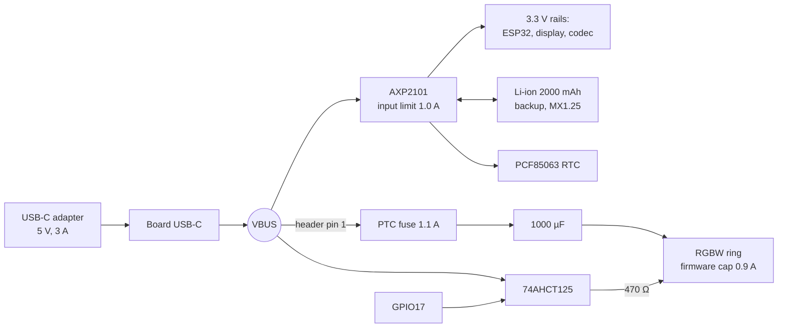

# Power design

Phase 1 · 2026-11-12 · Decisions: [D-012](DECISIONS.md), [D-013](DECISIONS.md), [D-014](DECISIONS.md)

**All currents below are estimates from datasheet-typical figures. None has been measured yet.**
Section 9 lists the bench measurements that replace them.

## 1. Architecture in one picture

- **USB-C is the main supply.** The ring takes 5 V directly from the header's VBUS pin.
- **The battery is a backup.** It carries the clock, the RTC and the alarm sound through an unplug or a power cut. The ring is off on battery.
- **No boost converter** in the baseline. Section 8 describes it as an optional upgrade.

## 2. LED ring load (24 × RGBW)

| Case | Channels on | Ring current at 5 V |
|------|-------------|---------------------|
| Powered but dark (driver quiescent, ~1 mA each) | none | ~25 mA |
| Night light, red at 3 % | R | ~40 mA |
| Reading light, white at 60 % | W | ~285 mA |
| White LED at 100 % | W | ~455 mA |
| Sunrise peak (white 100 % + warm tint) | W + R + part G | ~0.85 A |
| Everything at 100 % (never allowed) | R+G+B+W | ~1.75 A |

Per-channel figure used: 18 mA (Adafruit's stated constant current).

**Firmware current cap (R14):** before every frame, `light_fx` adds up
`I = 25 mA + Σ(r+g+b+w) × 18 mA / 255` over all 24 pixels.
If `I > 900 mA`, every channel is scaled down by `900 / I`. No mode can bypass this.

**Hardware backstop:** a 1.1 A-hold resettable fuse (Bourns MF-R110) in the ring's 5 V line. If firmware ever fails with all channels on, the fuse trips instead of the adapter or the board trace.

**Weak-charger guard:** `power_mon` reads VBUS voltage from the AXP2101 once a second while the ring is lit. Below 4.6 V the cap drops in 20 % steps until VBUS recovers.

## 3. Level shifting and protection parts

| Part | Value | Why |
|------|-------|-----|
| 74AHCT125 (one gate, VCC = VBUS) | — | The ring needs a data high of at least 0.7 × 5 V = 3.5 V. The ESP32 gives 3.3 V. AHCT reads 3.3 V as high and outputs 5 V. |
| Series resistor at ring DIN | 470 Ω | Damps ringing on the data wire and limits current into the first pixel. |
| Pull-down on gate input (GPIO17) | 10 kΩ | Holds data low while the ESP32 boots, so the ring doesn't flash random colours. |
| Bulk capacitor across ring 5 V/GND | 1000 µF, 10 V | Absorbs the current step when the ring changes brightness. If an adapter hiccups at plug-in from the inrush, drop to 470 µF. |
| Decoupling at the 74AHCT125 | 100 nF | Standard. |
| Unused gates (3) | inputs to GND, /OE to VCC | Stops them floating. |

AHCT inputs accept a signal while their own supply is off, so GPIO17 cannot back-feed VBUS when USB is unplugged. Firmware also parks GPIO17 low when VBUS is absent.

## 4. Power budget

Converted to current at the 5 V USB input (3.3 V loads ÷ 0.88 regulator efficiency).

| State | Board | Ring | Total at 5 V |
|-------|-------|------|--------------|
| A. Night clock, dim | 45 mA | 25 mA | **~70 mA** |
| B. White noise playing | 75 mA | 25 mA | **~100 mA** |
| C. Night light | 45 mA | 40 mA | **~85 mA** |
| D. Reading light 60 % | 50 mA | 285 mA | **~335 mA** |
| E. Sunrise at peak | 75 mA | 900 mA (cap) | **~1.0 A** |
| F. Alarm, full volume, sunrise full | 410 mA | 900 mA | **~1.3 A** |
| G. F + battery charging + Wi-Fi burst | 1000 mA (PMIC limit) | 900 mA | **1.9 A max** |

Board-side detail used above (at 3.3 V): ESP32-S3 ~40 mA average with radios idle, up to 340 mA in Wi-Fi bursts · AMOLED ~10 mA dim, ~100 mA full white · codec ~15 mA · sensors and PMIC ~5 mA · amplifier ~25 mA for white noise, ~1.2 W at full alarm volume.

**Adapter:** 5 V, **3 A**, USB-C (for example the Raspberry Pi 15 W supply, 5.1 V / 3 A). A phone charger of 2 A or more works; the weak-charger guard dims the ring if it sags. A laptop port (0.5–0.9 A) will run the clock but not the full sunrise.

## 5. PMIC (AXP2101) settings, applied at every boot

| Setting | Value | Reason |
|---------|-------|--------|
| VBUS input current limit | 1000 mA | Leaves the rest of the adapter for the ring. |
| Battery charge current | 400 mA (0.2 C for 2000 mAh) | Gentle on the cell, low heat in a closed case. |
| Charge target voltage | 4.2 V | Standard Li-ion. If the clock lives on USB permanently, 4.1 V roughly doubles cell life (owner choice). |
| PWR-key long-press power-off | Disabled (or 10 s if it can't be disabled) | R27: no accidental power-off. |
| IRQs enabled | VBUS insert/remove, battery low, charge done, PWR key | Read through TCA9554 P5; also polled every 1 s. |
| Fuel gauge | Enabled | Battery % for R24/R25. |

Register names and library calls are confirmed in Phase 3 against the AXP2101 datasheet.

## 6. Battery (backup) and runtime

**Recommendation:** 3.7 V Li-polymer, **2000 mAh, size 103450** (10 × 34 × 50 mm), with built-in protection board, **MX1.25 2-pin** plug.

> **Check polarity before plugging in.** Hobby cells often have red and black swapped relative to a given board. With a multimeter, confirm the plug's positive pin lines up with the "+" marking by the board's battery connector. Reversed polarity can destroy the PMIC. Waveshare's documents do not state the polarity in text, so this must be checked on the board itself.

Usable energy: 2000 mAh × 3.7 V = 7.4 Wh, × 0.8 (ageing, cut-off) = **5.9 Wh**.

| On battery | Power | Runtime |
|------------|-------|---------|
| Clock only, dim | 0.20 W | ~29 h |
| White noise continuously | 0.35 W | ~17 h |
| Alarm at full volume, screen white | 2.0 W | (0.33 Wh per 10 min) |
| **One unplugged night: 8 h white noise + 10 min alarm** | — | **3.1 Wh = 53 % of usable** |

So a 2000 mAh cell covers a full unplugged night with about 47 % left. A 1000 mAh cell does not (it has ~3.0 Wh usable).

Without any battery: the clock works on USB, but an unplug or power cut stops it and the RTC loses the time. On power return it shows "Set time" until Wi-Fi or the phone resyncs it. Any alarm in that gap is missed.

## 7. Behaviour on power events

| Event | What the clock does |
|-------|---------------------|
| USB unplugged | Ring goes dark at once (it has no supply). Sound and screen continue on battery with no reset. Screen shows a small "on battery" mark. |
| USB unplugged during sunrise or alarm | Alarm continues with sound. The screen ramps to full white in place of the ring. |
| USB plugged back | Ring resumes whatever it should be showing. Charging restarts. |
| Bedtime on battery (unplugged after 20:00, or white noise started on battery) | Works out energy needed until the next alarm plus a 0.4 Wh alarm reserve. If the battery has less than 1.25 × that, shows "Plug me in" and chimes (R24). |
| Battery < 25 % | White noise fades out. Wi-Fi and Bluetooth off. Screen at minimum (R25). |
| Battery < 10 % | Screen off unless touched. Only the alarm path runs. |
| Battery < 4 % or < 3.3 V | Saves state, then powers down cleanly (R31). |
| Power returns after shutdown | Boots, restores time from the RTC, fires any alarm missed in the last 60 min (R20). |
| Brownout (3.3 V rail dips) | ESP32 brownout detector resets the chip. Boot logic resumes the alarm stage from the clock time (R21). |

## 8. Optional upgrade: sunrise light on battery

Not built in the baseline. Add it only if you want the full sunrise when unplugged.

- Splice a tap into the battery leads (the header has no battery pin).
- Adafruit PowerBoost 1000 Basic (#2030): battery in, 5 V / 1 A out, with an enable pin driven from GPIO18.
- Two Schottky diodes (1N5822) to combine VBUS and boost output into the ring's supply.
- Battery of at least 3000 mAh. A 30 min sunrise costs about 1.2 Wh extra.

## 9. Bench measurements to replace the estimates

| # | Measure | Expect | Feeds |
|---|---------|--------|-------|
| M1 | USB current in states A–F (inline USB meter) | within ±30 % of §4 | R29, T-29 |
| M2 | VBUS at the ring with the ring at the 0.9 A cap | ≥ 4.6 V | R32, T-32 |
| M3 | Ring current at white 100 % and at the cap | ~0.46 A, ≤ 0.9 A | R14, T-14 |
| M4 | Battery runtime with white noise | ≥ 12 h | R30, T-30 |
| M5 | Which rail feeds the NS4150B amplifier | sets real max speaker power | HARDWARE §4 |
| M6 | Temperature of ring and PTC after 30 min at the cap | < 60 °C | Phase 4 enclosure |
